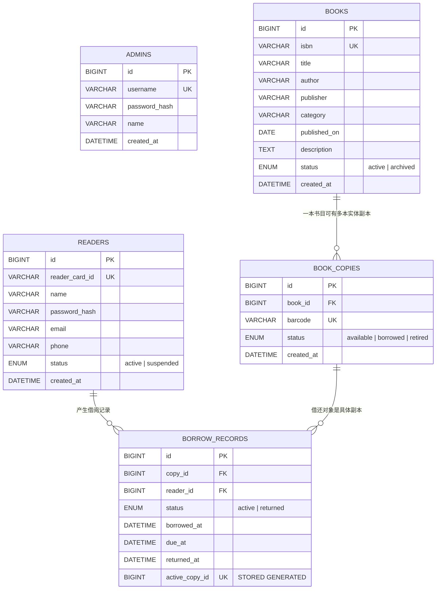
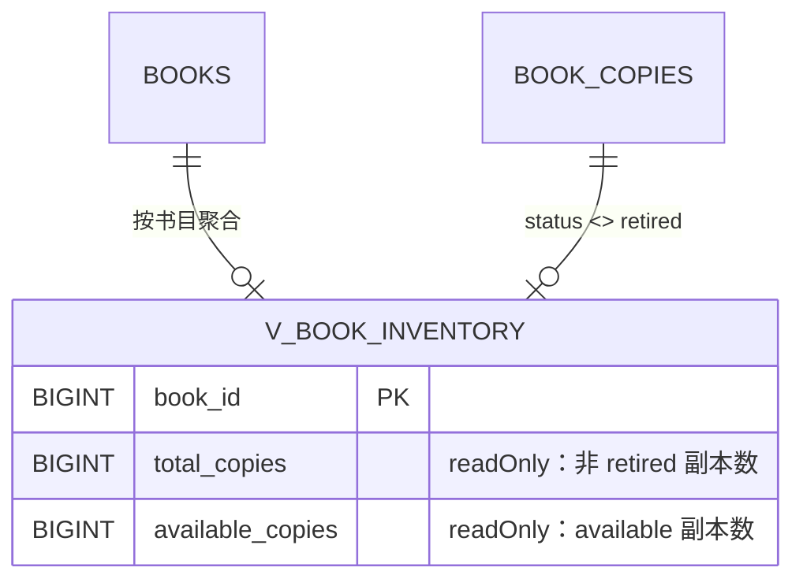

# LibraCore ER 图

> 维护人：zyj｜版本：v1.0｜对应 [`docs/database-dictionary.md`](database-dictionary.md) v1.0
> 第 8 周 Z1 交付物之一。数据库：MySQL 8 `libra_core`。

## 实体关系图

`ADMINS` 为独立账号表，与借阅业务无直接关联（认证模型待团队评审）。

## 派生视图（非实体）

## 关键设计说明

1. **书目 ≠ 副本**：`books` 只存元数据；每一本可外借的实体图书是 `book_copies` 中的一行。借书提交的是 `copy_id`。
2. **计数不冗余**：`total_copies` / `available_copies` 由 `v_book_inventory` 实时聚合，接口层只读，避免计数与副本状态不一致。
3. **软删除**：书目归档用 `books.status='archived'`，读者注销用 `readers.status='suspended'`，副本退藏用 `book_copies.status='retired'`；均不物理删除，借阅历史永久保留。
4. **并发一致性**：`borrow_records.active_copy_id` 是 STORED 生成列并带 UNIQUE 索引，保证同一副本同时只能有一条 `active` 借阅记录；`returned` 记录该列为 NULL，可累积历史。
5. **逾期是推导值**：不设 `overdue` 状态，由 `status='active' AND due_at < NOW()` 判断。

## 关系基数与外键

| 关系 | 基数 | 外键 | 删除策略 |
| --- | --- | --- | --- |
| books → book_copies | 1 : N | `fk_copies_book` | `ON DELETE RESTRICT`（有副本的书目禁止物理删除） |
| book_copies → borrow_records | 1 : N | `fk_loan_copy` | `ON DELETE RESTRICT`（有借阅历史的副本禁止删除） |
| readers → borrow_records | 1 : N | `fk_loan_reader` | `ON DELETE RESTRICT`（有借阅历史的读者禁止删除） |

原 v0.1 中 `fk_borrow_reader` 使用 `ON DELETE CASCADE`，会随读者删除一并抹掉借阅历史，v1.0 已修正为 RESTRICT 并改为软注销。
