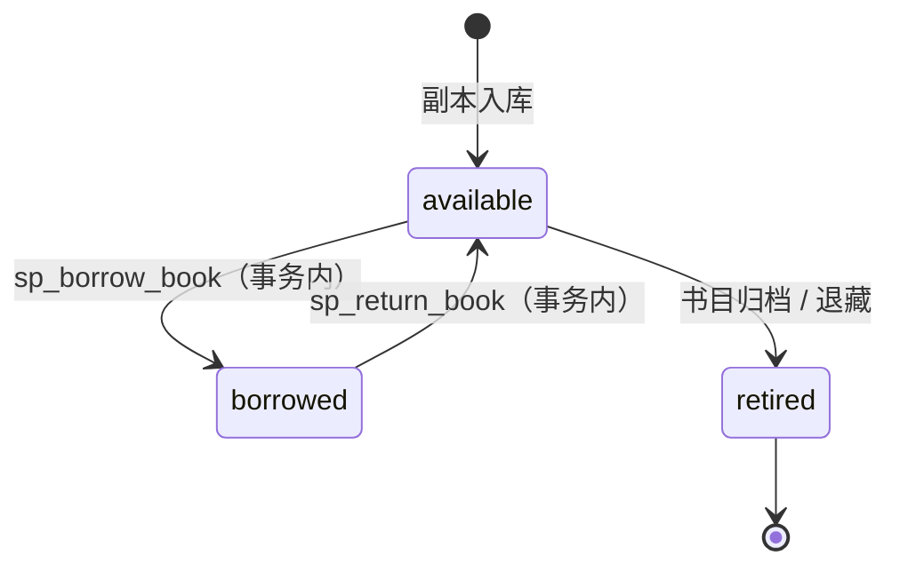
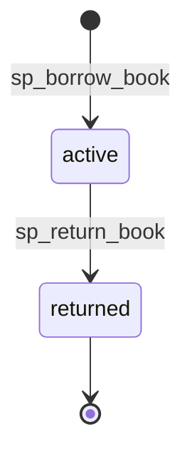

# LibraCore 借还业务规则与状态流转（第 10 周 / M3）

> 维护人：zyj｜版本：v1.1｜更新日期：2026-11-06
> 范围：**数据库层**规则。Controller / 借还 Service / 权限校验由 lkx 负责；界面由 dhw、hyq 负责。
> 依据：`docs/开发计划.md` 第 10 周、`docs/第8周任务清单.md`、`api/openapi.yaml` 0.2.0-draft 的 Loan / Copy。

## 1. 设计前提

- 借还对象永远是**具体馆藏副本 `copy_id`**，不是书目 `book_id`（书目 ≠ 副本）。
- 逾期**不是独立状态**：`status='active' AND due_at < NOW()` 即逾期，由接口层/Qt 端展示。
- 借还与归还必须在**同一个事务**内同时更新 `borrow_records` 与 `book_copies`，不允许只改一边。
- 所有业务错误以 SQLSTATE `45000` + 固定 `MESSAGE_TEXT` 抛出，便于 Controller 映射为契约的 409/404/422。

## 2. 借还规则表

| 规则 | 当前实现 | 说明 |
| --- | --- | --- |
| 借期长度 | 由调用方传入 `p_loan_days`，默认 **30 天** | 契约待评审项 `loan-policy`，**未替团队定死**；Service 层确定后传参即可 |
| 单读者借阅上限 | 未限制 | 待评审项，需要时加事务内 `COUNT(*)` 校验 |
| 续借 | 未提供 | 第 8 周已明确不做；若后续要做，应新建归还+再借流程而非改 due_at |
| 逾期判定 | `due_at < NOW()` | 由视图 `v_overdue_loans` 提供，不写回状态 |
| 借书权限 | 数据库层校验 `readers.status='active'` | 角色鉴权（reader/admin）由 Controller 的令牌校验负责 |
| 重复借阅 | 事务内 `SELECT ... FOR UPDATE` + 副本状态检查；另有 `uk_loan_active_copy` 唯一约束兜底 | 对应契约 409 `COPY_UNAVAILABLE` |
| 重复还书 | 只有 `status='active'` 的记录会被更新，重复还影响 0 行 → `ALREADY_RETURNED` | 对应契约 409 `ALREADY_RETURNED` |
| 无效读者/副本 | `READER_NOT_FOUND` / `COPY_NOT_FOUND` | 对应 404 |
| 停用读者 | `READER_SUSPENDED` | 对应 403/422，由 Controller 决定 |
| 归档书目 | 仍有 `borrowed` 副本时拒绝归档 | 见 `BookRepository::deleteBook` |

## 3. 副本状态流转

约束：`borrowed` 状态的副本**不允许退藏**；`retired` 不计入 `v_book_inventory.total_copies`；`status` 只能由借还事务或退藏操作改变，禁止直接 PATCH。

## 4. 借阅记录状态流转

`active` 期间若 `due_at < NOW()`，视图标记为 `is_overdue=1`，但**记录状态仍是 active**，不新增 overdue 状态。`returned_at` 在 `active` 时为 NULL，由 CHECK 约束保证 `returned` 时非空。

## 5. 一致性不变量（数据库层保证）

1. 一条 `active` 借阅 ⟺ 对应副本为 `borrowed`（由存储过程事务保证）。
2. 同一副本同时最多一条 `active` 借阅（`active_copy_id` STORED 生成列 + UNIQUE，returned 时为 NULL 可累积历史）。
3. `returned` 记录的 `returned_at` 必非空（`chk_loan_returned_at`）。
4. `total_copies` / `available_copies` 由 `v_book_inventory` 从副本实时聚合，不存在冗余计数。
5. 任何失败（重复借、无效读者、唯一键冲突）都 `ROLLBACK`，副本状态与借阅记录一起回滚，不留半更新。

## 6. 事务实现位置

事务放在 `database/procedures.sql` 的两个存储过程里，而不是 C++ 层：

- 好处：数据库层可独立、真实地验证（含并发），且 C++ 层不依赖 Drogon `Transaction` API 的具体用法。
- `sp_borrow_book(p_copy_id, p_reader_id, p_loan_days)`：校验读者 → `FOR UPDATE` 锁副本 → 改 `borrowed` → 插 `active` 记录 → COMMIT。
- `sp_return_book(p_loan_id)`：`FOR UPDATE` 锁记录 → 校验 active → 改 `returned` + 写 `returned_at` → 副本回 `available` → COMMIT。
- 两者都有 `EXIT HANDLER FOR SQLEXCEPTION → ROLLBACK → RESIGNAL`。

`LoanRepository` 只做 `CALL` 与查询的薄封装，签名见 [`docs/repository-contract.md`](repository-contract.md)。

## 7. 派生视图

| 视图 | 用途 |
| --- | --- |
| `v_loan_history` | 借阅明细（JOIN 副本、书目、读者），含 `is_overdue` 推导 |
| `v_active_loans` | 当前未归还借阅 |
| `v_overdue_loans` | 逾期借阅（`active` 且 `due_at < NOW()`） |

`v_loan_history` 一次性补齐 `book_id/title/author/reader_name`，避免契约待评审项 `loan-denormalization` 提到的 Qt 借阅列表 N+1 请求。

## 8. 待团队评审（本版未做决定）

| 契约 key | 本版处理 |
| --- | --- |
| `loan-policy` | 借期由 Service 传参，默认 30 天；上限/续借/罚则未定 |
| `duplicate-loan-code` | 沿用 `COPY_UNAVAILABLE`，未新增 `DUPLICATE_LOAN` |
| `loan-denormalization` | 通过 `v_loan_history` 冗余展示字段，Loan 表本身不冗余 book_id |
| `soft-delete-semantics` | 沿用 `status` 字段，未引入 deleted_at |
| `reader-account-model` | readers/admins 分表保持原样 |

## 9. 测试覆盖

`tests/database/verify_loans.py` 在真实 MySQL 上覆盖：正常借→查→还、重复借、重复还、无效读者/副本、停用读者、**两个连接并发争抢同一副本**、以及每步之后的 SQL 状态核对。结果写入 `tests/database/results/verify-loans-<日期>.txt`。
